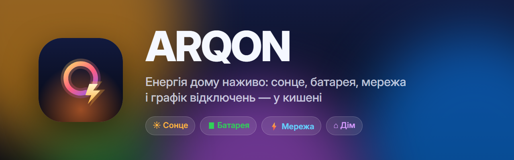
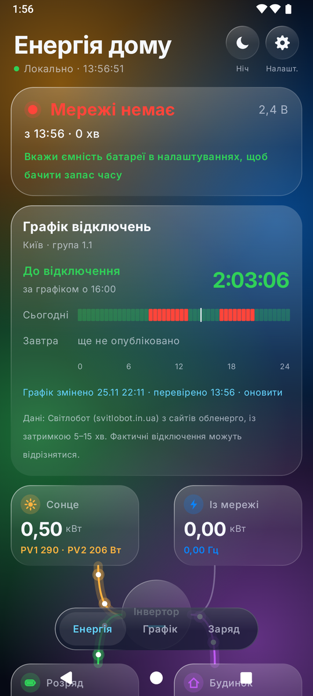
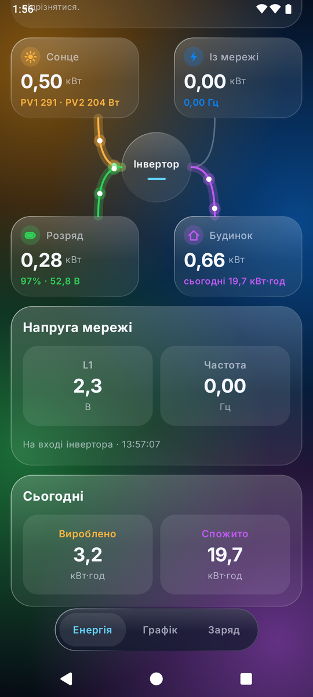
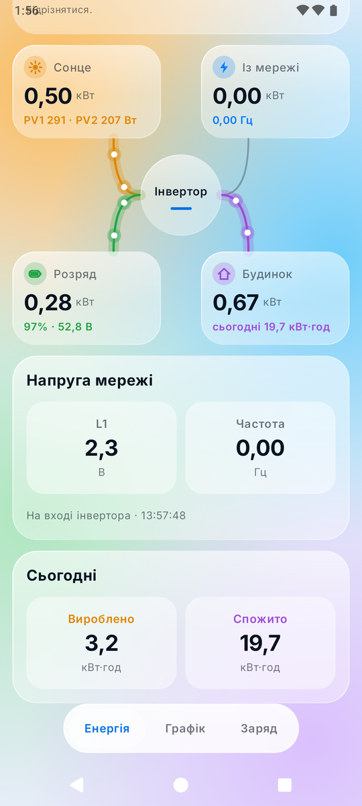
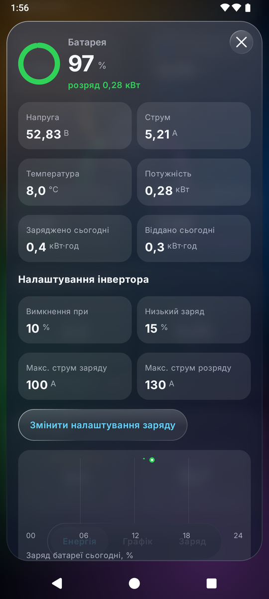
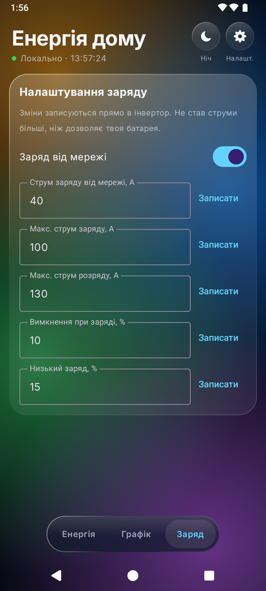
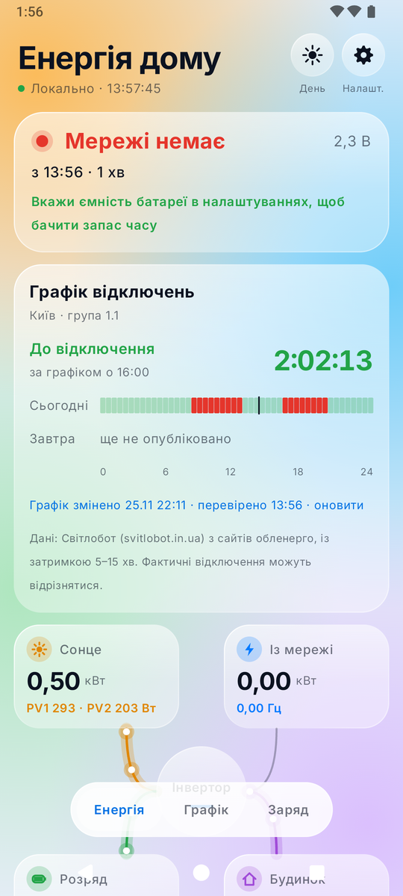

  

  
  
  
  

<h3 align="center">
  <a href="https://github.com/dev-marik/arqon-releases/releases/latest">⬇ Завантажити ARQON для Android</a>
</h3>

**ARQON** показує, що відбувається з енергією в домі: скільки дає сонце, чим живиться дім, як заряджається батарея і чи є світло в мережі. Щосекунди, напряму з інвертора, без хмар. Плюс графіки відключень і лічильник до наступного.

> Це сторінка завантаження. Код додатка закритий.

## Скріншоти

| Дошка | Потоки енергії | Світла тема |
|:---:|:---:|:---:|
|  |  |  |
| **Батарея** | **Керування зарядом** | **Світла тема, графік** |
|  |  |  |

## Що вміє

- ⚡ **Наживо, локально.** Читає інвертор через Wi-Fi-логер Solarman щосекунди, без хмари. Логер знаходить сам.
- 🔌 **Світло є чи ні.** Сповіщення, коли світло зникло й з'явилося, скільки його не було, коли батарея сідає.
- 🗓 **Графік відключень** для 18 регіонів України з лічильником до ввімкнення чи відключення.
- 📊 **Статистика** за день, тиждень, місяць, рік і економія за твоїм тарифом.
- 🔋 **Керування зарядом** Deye однофазного гібрида: струми й пороги заряду.
- ☁ **SmartESS:** інвертори з вбудованим Wi-Fi Eybond (наприклад Sandisolar) — через хмару.
- 🎨 Скляний інтерфейс, денна й нічна тема, віджет на головний екран.

## Сумісні інвертори

✅ перевірено на реальному інверторі, решта працює за описом регістрів і чекає тестерів.

| Марка | Моделі |
|---|---|
| **Deye** | ✅ SG0\*LP1 (однофазний гібрид) · SG0\*LP3 / SG0\*HP3 · G0\* · мікроінвертори |
| **Sandisolar** | SD / SD-Pro · через SmartESS |
| **Sofar** | G3 · гібрид · мережеві |
| **Solis** | 1P 5G · 3P 4G · 3P 5G · гібрид · S6 GR1P |
| **Afore, Kstar, SRNE, Anenji** | гібриди |
| **Інші** | Astro Energy · Chint · Hinen · INVT · Maxge · Megarevo · Renon · Swatten · TSUN |

Потрібен Wi-Fi-логер Solarman (окремий модуль на інверторі) або вбудований Wi-Fi з застосунком SmartESS.

## Як встановити

1. Відкрий [останній реліз](https://github.com/dev-marik/arqon-releases/releases/latest) на телефоні й натисни файл `ARQON-….apk` у розділі **Assets**.
2. Відкрий завантажений файл. Android попросить дозволити встановлення з браузера — дозволь (це звичайне попередження для додатків не з Google Play).
3. Підключи телефон до тієї ж Wi-Fi, що й логер інвертора, відкрий ARQON → ⚙ Налаштування → **«Знайти логер автоматично»**.
4. Для Deye модель визначиться сама; для інших марок обери модель у налаштуваннях. Для Sandisolar та інших зі SmartESS — розділ **«Хмара SmartESS»**, логін і пароль від застосунку SmartESS.
5. За бажання: **«Графік відключень»** → регіон і група; **«Стежити у фоні»** — для сповіщень.

Нові версії ставляться поверх старої, налаштування зберігаються.

## Відгук

Знайшов помилку, хочеш додати свій інвертор чи маєш ідею — [напиши тут](https://github.com/dev-marik/arqon-releases/issues/new/choose) (потрібен безкоштовний акаунт GitHub). Скріншот ARQON поруч із застосунком виробника дуже допомагає.

---

© 2026 ARQON. Усі права захищені. Додаток використовує описи регістрів [ha-solarman](https://github.com/davidrapan/ha-solarman) (MIT), шрифт [Inter](https://github.com/rsms/inter) (SIL OFL 1.1) і графіки [Світлобота](https://svitlobot.in.ua) (CC BY 4.0); тексти ліцензій — усередині додатка. Deye, Sofar, Solis, Sandisolar, SmartESS та інші назви належать їхнім власникам. Протокол SmartESS неофіційний і може змінитися.
